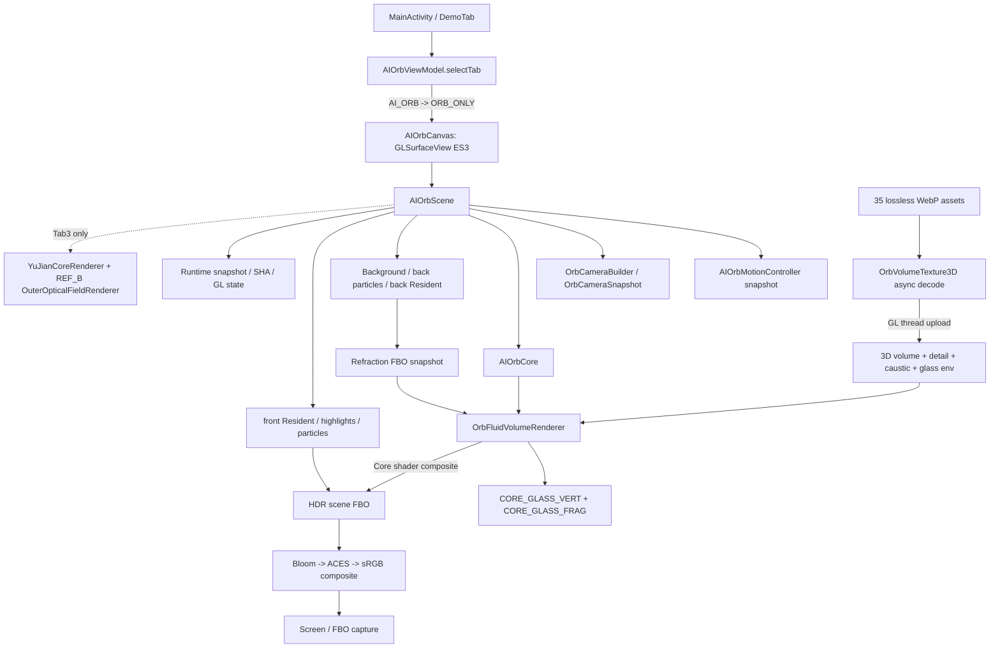

# Tab1 架构图

本图描述冻结 HEAD 的正式实现，不代表本轮已修改代码。Tab1 使用唯一 `AIOrbScene` 与原生 Demo Core；YuJian Core/REF_B 外围场仅由第三 Tab 的独立 sceneMode 分支启用。

## 边界

- Tab1 主链：`AI_ORB -> ORB_ONLY -> AIOrbScene.renderOriginalOrbOnlyFrame -> AIOrbCore -> OrbFluidVolumeRenderer -> CoreFluidShaders`。
- 同一 `GLSurfaceView` / scene 也承载 Tab2 与历史第三 Tab；Tab 切换靠 `OrbSceneMode`，不是另外创建摄像机或 Renderer。
- `AIOrbInnerFluid.kt` 存在，但在当前活动 Tab1 路径内没有调用点；AIOrbCore 将工作委托给单一 V3 Volume Renderer。
- `REFERENCE_ONLY` 是 Compose 的静态 QA 图，不是 GPU 场景复合图；不得作为 GPU 验收结果。
- `RIBBONS_ONLY` 与 `RESIDENTS_ONLY` 是不同诊断语义，capture manifest 与活动绘制条件必须分别校验。
